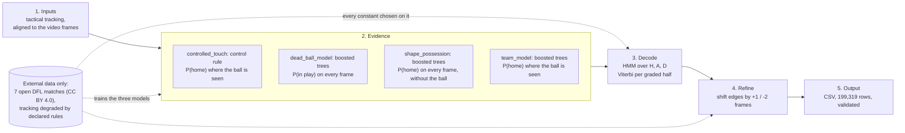

# Un Dia de Partit: technical document (More than a Hack 2027, Phase 1)

- **Team:** Tian Ključanin, Andrea Molteni, Jakob Wilhelm Fidelio Nunnendorf, Balázs Molnár, Kamel Brouthen
- **Code:** https://github.com/TianK003/BarcaHackathon, commit `e66b153` (later commits change documents only)
- **Submission:** `Un Dia de Partit.csv`, the file `pipeline/configs/main.toml` writes, sha256
  `aae79a0446dabdf565d86b95f03acf0a53b5698cf3d80033c25bf7d49cbd3bdb`
- **PDF:** the uploaded `Un Dia de Partit.pdf` is this text in the IEEE conference format, built from
  docs/technical_document_submission.tex.
- **Full record:** docs/technical_document.md in the repository, with every experiment and analysis (numbers,
  commands, failures) in docs/results.md and our reading of the rules in docs/rules.md.

## 1. Approach

**The problem.** The ball is missing on 41% of the graded frames, in long gaps (median 10.7 s). Where it is seen,
the nearest player's team is the possessor only about 78% of the time, and a missing ball is not a dead ball: the
ball is visible on most dead frames. The organisers' unsmoothed baseline fragments (131 possessions in the public
window against 17 real ones), which is fatal for spellF1. So the question is how to hold a team through long stretches
without a ball and change it only on real evidence.

**The pipeline** has five stages: inputs → evidence → decode → refine → output. Each evidence source gives, per
frame, P(ball in play) or P(home has it), or no opinion. There are four:

| source | what it is | speaks |
|---|---|---|
| `controlled_touch` | a control rule on the ball and the nearest players (section 5) | where the ball is seen |
| `dead_ball_model` | boosted trees on 30 features of the play (where the ball vanished and reappeared, the players' slowdown, set-piece shapes) | every frame: in play or dead |
| `shape_possession` | boosted trees on 42 features of how the two teams stand and move, none reading the ball | every frame, so also inside ball gaps |
| `team_model` | boosted trees on 72 features: the ball against each team (distances, closing speed, time to reach it) and the 42 shape features | where the ball is seen |

**The pipeline in one picture.** Solid arrows carry the provided match through the five stages at run time. Dashed
arrows show where learned models and chosen constants come from: other games only, never the provided match.



**The decoder** is a three-state hidden Markov model over `H`, `A` and `D`, decoded by Viterbi over each graded
half. Each source adds its log-likelihood to the states it speaks for; silence adds nothing. A change of team has a
cost (6 nats), a change into or out of `D` a larger one (32), and a run lasts at least 1.4 s for a team and 1 s for
`D`. A possession is then an interval whose two edges must be paid for, which is what spellF1 scores. A last step
moves a change of team 1 frame later and a change into `D` 2 frames earlier: the pipeline's own median lag on the
benchmark, negated.

**Why this and not something else.** The rules allow training and tuning on external data only. So the three models
are trained on other matches, and every numeric constant is chosen on a benchmark of other matches (section 6).
Boosted trees on hand-built features suit that: they train on a CPU, are committed as JSON files, and each feature
can be checked against how our tracking differs from the training data. The decoder is there because spellF1
punishes flicker: evidence may be noisy per frame, but a possession has to be worth its two edges.

## 2. Assets used and dropped

| asset | used | how, or why not |
|---|---|---|
| Tactical tracking (ATD) | yes | the only input of every source |
| Smart Tagging | no | automatic tags; their confidence could only be measured on this match, which the rules forbid, so the source was removed before submission |
| Tactical homography | no | analysed only: the camera's aim is too coarse a proxy for the ball (median error 12 m along the pitch) |
| Tactical video and audio | no | a whistle detector on the audio was tried and failed its gate |
| Broadcast video, tracking, homography | no | its own timeline with cuts and replays, and no mapping to the tactical frames |
| Public 5-minute ground truth | check only | a correctness check of the finished pipeline (sections 3 and 6) |

**Tried and dropped,** each by a bar declared before its run (docs/results.md has the numbers): the restarting team
by restart type; the referee's whistle; the camera's aim as a ball proxy; repairing wrong-team track slots; a
pretrained event model (PathCRF); recalibrating the shape model per half; placing edges by the decoder's posterior;
the broadcast's ball inside our gaps; and several further features and decoder variants in the last week. None of
them is in the submitted configuration.

## 3. Training data

We labelled nothing by hand, on any game. Everything learned comes from one external dataset:

| data | source and licence | who labelled it | how much | used for |
|---|---|---|---|---|
| DFL/IDSSE open data: `BallStatus` (in play or dead) and `BallPossession` (the team), per frame | Bassek et al. 2025, figshare, CC BY 4.0 | DFL, in its official match data; the paper says operators check all data | 7 full matches (2 Bundesliga, 5 2. Bundesliga), 25 Hz, 668 graded minutes | training the three models; choosing every constant; validation. Its 681 restart events only as a diagnostic of a dropped source |

Three other external sources were read and nothing in the submission stands on them: PathCRF's public checkpoint
(Kim et al. 2026, MPL-2.0; measured once, dropped); SkillCorner's open data (MIT; a plausibility check of the
benchmark's ball gaps, made after they were declared); and the events of Metrica's three sample games (used once to
measure how fine possession is in our provider's data, then withdrawn on 5 Nov because the data has no licence;
ranking on two truths, section 6, was kept on its own ground: neither is known to be right).

**Nothing was trained, fitted or tuned on the provided game.** No tracking was corrected by hand, no human-produced
data about the match was used, and no output of ours was checked against the video. The public 5 minutes were used
as a correctness check (alignment, a valid and deterministic file, each source pointing the right way) and
inspected to understand what counts as possession; no model saw them and no constant of the submission was set on
them.

**Three things we state openly:**

- *Two published figures.* The benchmark's degradation (section 6) quotes two statistics of this match from the
  organisers' DATA.md: the ball is missing on 41% of the graded frames, and 20.5 objects are tracked on average. We
  read them as public information of the task statement, given to every team, not as use of the provided data.
- *An earlier benchmark, retired.* Until 9 Nov the degradation was fitted on label-free statistics of our own
  tracking (which frames have no ball, how long the tracklets are). After the organisers' reply of 5 Nov ("anything
  that is not explicitly allowed is not permitted") we retired it, retrained the models and chose every constant
  again on a degradation that measures nothing of our match. Only the architecture (which components exist, the
  trees' settings) comes from the old one, re-verified on the new.
- *The Smart Tagging,* a source in earlier versions, was removed for the same reason (section 2).

## 4. Missing and noisy tracking

- **Long ball gaps.** No interpolation: gaps under 2 s hold 0.1% of the missing frames. The decoder keeps its state
  through a gap, and the shape model speaks inside it (out of fold on the benchmark, the submitted version names the
  right team on 86% of the in-play frames without a ball).
- **A missing ball is not a dead ball.** `D` never comes from ball presence alone; the dead-ball model reads where the
  ball vanished and reappeared and how the players behave.
- **The ball-speed channel is unusable** (empty on 92% of the frames with a ball). Every speed comes from successive
  positions.
- **Track slots are tracklets, not players** (46 slots for 22 players). No feature follows a slot over time; the
  shape features are aggregates over each team's players.
- **Wrong-team slots.** One team shows more than 11 slots on at least 10.8% of the graded frames. Such slots
  do not cluster at the ball, so a repair was judged not worth it; this stays a limitation (section 7).

## 5. Possession rules implemented

- **Control.** A team controls the ball when the nearest tracked player is its own and within 1.5 m, no opponent is
  within 1.0 m, and the ball moves with that player (relative speed at most 6 m/s): a proximity rule in the line of
  Link and Hoernig (2017) and Vidal-Codina et al. (2022). A run of such frames votes for its team from its first
  frame, so a change lands where control began.
- **Loose balls** (a pass in flight, a rebound). While the ball is seen but nobody controls it, the rule keeps a
  weaker vote for the last controlling team. Possession stays with that team unless the other evidence outweighs
  it.
- **Challenges.** With an opponent within 1 m there is no control, so the previous team keeps the ball until one
  side controls it. A touch of a frame or two becomes a possession only if the evidence around it pays the
  decoder's switch cost and lasts 1.4 s.
- **Dead ball and restarts.** `D` is the dead-ball model's, and every graded frame before a half's documented
  kick-off is `D`. After a restart the weaker vote still favours the team that had the ball before the stoppage,
  until a player controls the ball; we do not use the restart type. Who owns a dead ball is not asked.
- **A change of team inside a ball gap** falls where the shape evidence for the other team pays the switch cost.
- **Not implemented:** aerial duels (no ball height), pass and interception events, and abstention (tried and
  dropped: no `X` on a graded frame).

## 6. Validation and results

**The benchmark.** The public window holds 17 possessions and is the best-tracked part of the match, so it cannot
rank anything, and the rules forbid tuning on it. We validate on the seven DFL matches instead. The truth is built
as ours is (`D` where the ball is dead, else the team in possession), the tracking is degraded to resemble ours by
rules declared before any run (ball gaps of 1 to 60 s covering 41% of the frames, players dropping out, 46 slots),
and the official scorer grades each half. DFL's possession flag is fine-grained and the grain of ours is unknown, so
every choice is ranked on the mean of two truths: DFL's own ("raw") and one that absorbs possessions under 5 s
("coarse"). Every change had to clear a bar declared before its run, tested over the seven matches.

| pooled spellF1 on the benchmark | raw | coarse |
|---|---|---|
| nearest player + majority vote, the organisers' baseline (the better of its 50- and 125-frame windows) | 0.1885 | 0.2092 |
| touch rule + dead-ball model + shape model + HMM | 0.5414 | 0.5829 |
| + shape model version 2 and the team model: **the submission** | **0.5891** | **0.5963** |

Measured before the last two models were added: on the mean of the two truths, the score falls by 0.10 without the
shape source and by 0.03 without the touch rule. A perfect dead-ball source would add only 0.03 to 0.04, a perfect
team source about 0.2 where the ball is seen and 0.10 to 0.18 inside the gaps: what is left to win is who has the ball.

**On our match, checks that pass or fail only.** The file validates, has no `X` on a graded frame and comes out
byte-identical on repeated runs. Its `D` share is 34.4% of the graded frames, inside a band set on DFL; it holds 386
possessions (`H` 38.2%, `A` 27.4%). On the public window it scores macroF1 0.7199 and spellF1 0.4737: a check for
gross errors, which chose nothing.

## 7. Limitations

- **A change of team inside a ball gap is found late; this is the largest error left.** On the benchmark, where
  the ball is seen a change lands within a few frames; inside a gap it lands late (a median of 6 frames at a
  possession's start and 11 at its end, the upper quartile near one second). Late in each half the ball is missing
  on up to 80% of a 5-minute block, and there the team rests on the shape model alone, trained on other teams.
- **The benchmark is not our tracking.** Its ball gaps ignore the play, while ours fall where the tracker loses the
  ball (more often near the lines), and it has no wrong-team slots. So its scores are not a forecast for the real
  match; it overstates the dead-ball model in particular, by an amount we cannot measure.
- **The team model has no transfer check on our match,** and wrong-team slots hit it hardest, since it reads
  distances per team. The benchmark's test of this realised a team with more slots than players on at most 2.3% of
  the graded frames; our match shows one on at least 10.8%.
- **Seven German matches,** five of them one club's home games: the models may transfer imperfectly to LaLiga, and
  several constants were chosen within noise of their neighbours.
- **Our truth's conventions are unknown:** how short a possession may be, and when exactly `D` starts and ends. The
  models carry DFL's conventions, and the decoder's minimum of 1.4 s, chosen on the benchmark, rules out shorter
  possessions, which the public truth shows to exist.

**With more time:** recover the ball from the video with a detector trained on other matches; place the edges from
detected passes; learn our provider's timing from other games of the same provider, given data with a licence.

## 8. Reproduction

```bash
py -3.11 -m venv .venv                         # macOS/Linux: python3.11 -m venv .venv, then .venv/bin/python
.venv/Scripts/python -m pip install -r requirements-pipeline.txt
# unpack the data bundle into data/ as data/README.md describes
.venv/Scripts/python pipeline/run.py pipeline/configs/main.toml
```

`evaluation/results/main.csv` is the file the last command writes from `data/`. The run validates it with the
official checks and prints its sha256; the uploaded `Un Dia de Partit.csv` is that file renamed (sha256 above). Python
3.11.9; every package the pipeline imports is pinned (numpy 2.4.6, pandas 3.0.6). The models are JSON files in
`pipeline/models/`, so nothing is trained at run time and no GPU is needed; the run takes under a minute on a laptop
CPU. On 16 Nov the file came out with the same sha256 from fresh clones of the public repository, in fresh
environments, on two processors: an AMD Ryzen 5 5500U laptop (Windows, Python 3.11.9) and an Apple M2 (macOS,
Python 3.11.18). Earlier versions were also rebuilt under Linux. Retraining the models and repeating the benchmark needs
only the public DFL files: `requirements-benchmark.txt` and the commands in `pipeline/benchmark/README.md`.

**References.** Bassek et al. (2025), An integrated dataset of spatiotemporal and event data in elite soccer,
*Scientific Data* 12, 195 (data: doi:10.6084/m9.figshare.28196177, CC BY 4.0; we degrade its tracking). Kim et al.
(2026), PathCRF: Ball-free soccer event detection via possession path inference from player trajectories, KDD,
arXiv:2602.12080. Link and Hoernig (2017), Individual ball possession in soccer, *PLOS ONE*. Vidal-Codina et al.
(2022), Automatic event detection in football using tracking data, *Sports Engineering*, arXiv:2202.00804.
SkillCorner, open data: broadcast tracking of A-League matches (MIT). Metrica Sports sample data,
github.com/metrica-sports/sample-data.
