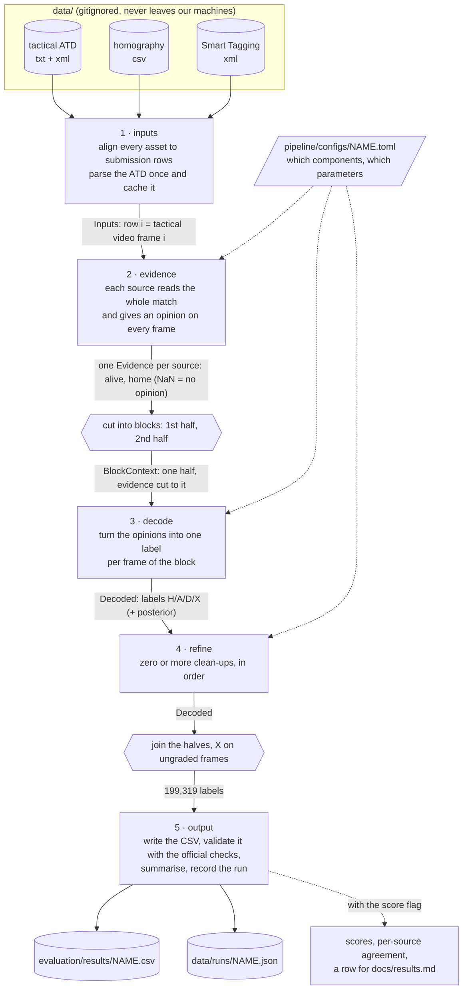

# The possession pipeline

One command goes from the data bundle to a validated submission CSV, and every run can be repeated byte for byte. The
pipeline is a chain of five stages. Each stage is a folder with its own README, and each has a small fixed contract,
so five people can work on different stages at the same time without stepping on each other.

```bash
python pipeline/run.py pipeline/configs/main.toml           # -> evaluation/results/main.csv, validated
python pipeline/run.py pipeline/configs/main.toml --score   # + public-window scores and per-source agreement
python pipeline/selftest.py                                 # contract checks on synthetic data (seconds)
python pipeline/selftest.py --data                          # + the real match: the 4 baselines, byte for byte
```

Use the team venv (`.venv/Scripts/python` on Windows, `.venv/bin/python` on macOS/Linux, Python 3.11.9). The first run
parses the tracking (~15 s); later runs of `main.toml` take about 17 s, nearly all of it the evidence (the play and
shape features and the trees; 14.9 of 17.1 s in the run of 25 Oct that wrote R011's file, with the cache warm).

## How it works



Two design decisions run through the whole diagram:

- **Opinions are separate from decisions.** Evidence sources say what the data suggests about each frame and never
  pick a label. The decoder weighs every source and pays for every label change. A new source therefore plugs in
  without touching the decoder, and a better decoder improves every source at once.
- **Decoders never see across halftime.** The runner cuts the evidence into one block per graded half before any
  decoder or refiner runs, and writes `X` outside the blocks, where nothing is graded. The per-half rule
  ([T11](../docs/traps.md)) holds for everyone without anyone having to remember it.

## The stages

| # | stage | takes | gives | its job | today | lands here |
|---|---|---|---|---|---|---|
| 1 | [inputs](inputs/README.md) | `data/tactical/*` and `games.py` | `Inputs`: read-only arrays where row *i* = tactical video frame *i*; graded halves, kick-offs, pitch size | do every alignment once and check it; parse the 195 MB ATD once and cache it | ATD (cached), homography, Smart Tagging | P10 audio, P14 ball from video, P15 broadcast |
| 2 | [evidence](evidence/README.md) | `Inputs` (the whole match) + config parameters | one `Evidence` per source: `alive` = P(ball in play), `home` = P(home has it \| in play), each float64 per frame, NaN = no opinion | per-frame opinions, never labels | `nearest_player` (baseline step 1; its optional `confidence` replaces the hard 0/1 vote), `ball_presence` (whether the tracker sees the ball, as `alive` evidence; P05 replaced it), `controlled_touch` (P04: `home` from control episodes and a weak hold for the last controlling team, NaN without the ball), `dead_ball_rules` and `dead_ball_model` (P05: `alive` from 30 play features, by fixed triggers or by a model loaded from JSON: gradient-boosted trees, or the logistic reference), `shape_possession` (P07: `home` from 26 features of how the two teams stand and move, none reading the ball, by boosted trees loaded from JSON; it speaks where the ball is missing and, in `main.toml`, at weight 0.3 on every graded frame since R030 (0.2 from R011 until then)), `restart_team` (P17: who restarts after a stoppage, from the players' arrangement; built and measured, not in `main.toml`, P17 dropped) | P08, P10, P11; A13 puts the remaining score in who has the ball (P04, P05 and P07 are in) |
| 3 | [decode](decode/README.md) | one block (a graded half) and every source cut to it | `Decoded`: one int8 label per frame (`H`, `A`, `D`, `X` = 0–3) and an optional posterior | turn opinions into a sequence that looks like football: intervals, few spurious changes | `majority_vote` (baseline step 2, a stand-in), `hmm` (P06: a Viterbi per block with switch penalties and minimum runs, and an optional posterior; restart states behind `restart_source`, P17, off by default) | duration priors beyond the minimums (semi-Markov) |
| 4 | [refine](refine/README.md) | the same block + the current `Decoded` | a new `Decoded`, same frames | metric-aware clean-ups, each switchable and measured | `shift_edges` (P02: each kind of edge moved by a fixed number of frames; every default is 0, and `main.toml` sets team +1, into_dead -2, out_of_dead 0, R012) | P11, P12 |
| 5 | [output](output/README.md) | labels for the whole match | the CSV (LF, validated, sha256), the run manifest; with `--score`, the scores | own the bytes of the deliverable and check them as the organisers will | — | — |

The runner ([`run.py`](run.py)) chains them, checks every hand-over (lengths, dtypes, value ranges, label codes),
and prints one line of aggregates per stage. It never prints a frame's data.

## The contracts

Defined once, in [`contracts.py`](contracts.py). A component is a plain function. Its keyword arguments are the keys
of its entry in the config.

```python
# evidence   pipeline/evidence/<name>.py   -- sees the whole match
def compute(run, **params) -> Evidence          # run.inputs, run.seed

# decoder    pipeline/decode/<name>.py     -- sees one block
def decode(ctx, **params) -> Decoded            # ctx.block, ctx.evidence (name -> Evidence, cut to the block), ctx.run

# refiner    pipeline/refine/<name>.py     -- sees one block
def refine(ctx, decoded, **params) -> Decoded
```

| type | fields |
|---|---|
| `Evidence` | `alive`, `home`: `(n,)` float64 in [0, 1], NaN = no opinion · `name`, `weight`: set by the runner from the config |
| `Block` | `half` (1, 2, or None for scope "file"), `start`, `stop` (half-open) · `take(array)` = `array[start:stop]` |
| `BlockContext` | `run` (`inputs`, `seed`), `block`, `evidence` (name → `Evidence` cut to the block, in config order) |
| `Decoded` | `labels`: int8 codes, the scorer's own (`H, A, D, X = 0, 1, 2, 3`) · `posterior`: `(len, 3)` P(H), P(A), P(D) or `None` |

Why `alive` and `home` rather than three numbers: the ground truth is `D` where the ball is dead and otherwise the
team that has it. Most sources answer only one of those two questions. Read together, they say
`P(H) = alive·home`, `P(A) = alive·(1 − home)`, `P(D) = 1 − alive`. The `hmm` decoder does not multiply them: it adds
each channel's log-likelihood ratio to the states it speaks for and lets a NaN add nothing, so a missing `alive` is no
opinion and not a coin flip ([decode README](decode/README.md#hmm-the-global-decoder-p06)).

## Configs

A run is one TOML file in [`configs/`](configs/), and its file name is the run's name:

```toml
description = "what this run tries"
seed = 0                   # all randomness derives from it
scope = "halves"           # one block per graded half; "file" only for the baseline reproduction

[[evidence]]               # one entry per source, any number
kind = "nearest_player"    # key in pipeline/evidence REGISTRY
# name = "..."             # optional; default = kind; must be unique
# weight = 1.0             # optional; how much the decoder trusts this source
# ...                      # every other key is a parameter of compute()

[decoder]                  # exactly one
kind = "majority_vote"
half_width = 50

# [[refine]]               # zero or more, applied in order
# kind = "..."
```

| config | what it is |
|---|---|
| [`main.toml`](configs/main.toml) | the team's current pipeline, i.e. the file we would submit today (not uploaded): `controlled_touch` (1.5 m, 6 m/s, 1 frame, confidence 0.93, hold 0.60) and `shape_possession` (weight 0.3, every graded frame) for `home`, the gradient-boosted `dead_ball_model` (weight 1.0) for `alive`, the `hmm` decoder (6 / 32 / 35 / 25) and `shift_edges` (team +1, into_dead -2, out_of_dead 0). **Since R030 (10 Nov 2026) every numeric constant is chosen, and both models are trained, on the benchmark's `generic` profile,** which measures nothing of our match (P27, [docs/rules.md](../docs/rules.md)); the architecture (which components exist, the trees' settings, `min_prob`, the hmm's structure) is inherited from the old benchmark and re-verified on `generic`. On `generic` it scores 0.5414 raw and 0.5829 coarse pooled spellF1 (mean 0.5622), against 0.5388 and 0.5779 (mean 0.5584) for the constants it replaced, and it passes the bar against the yardsticks with 7 wins in 7 under each truth. Against R029's file: both model files retrained, the hold 0.55 → 0.60, `switch_team` 4 → 6, the shape weight 0.2 → 0.3; the rest is unchanged. The hold and the decoder were decided by the tie-break declared before the runs, both on a knife-edge, and are listed for Tian's review. The file's sha256 and the checks on our match are in [R030](../docs/results.md). *How it got here:* P05 was chosen in R009 and R010 and P07's model in R011; R013 chose the touch rule, `switch_team`, `min_possession` and P07's weight again with no window-derived value in any candidate, and re-derived the shift by R012's rule, all on the benchmark; R017 then added `smart_tagging` at Tian's pick of its strength (untested on any benchmark, DFL has no tags, so the benchmark runs this file with `--drop-match-only`); R024 re-chose R013's two stages under R023's objective, the mean of the raw and coarse pooled spellF1s, and moved only the hold, from 0.60 to 0.55 (benchmark 0.5363 raw and 0.5764 coarse, mean +0.0052, p 0.0469, 6 wins in 7; sha256 `e6496a9b…`); R029 (3 Nov) took `smart_tagging` out again under the organisers' rules of 3 Nov, because its `c_team` was measured on our match ([docs/rules.md](../docs/rules.md)): the benchmark score was R024's, since the benchmark always dropped the source, and the file was sha256 `762f9073…`. Every score in this history is on `tracking` v3, the old default profile, which was fitted on our match; since the organisers' reply of 5 Nov that fit is, by our reading, not permitted, which is why R030 redid the models and the choices on `generic` (the benchmark overstates P05 for our match on either profile, T38, T39, and its gains are not a forecast for it) |
| [`r024_both.toml`](configs/r024_both.toml) | R024's adopted config, written when it was chosen: R017's file with the hold at 0.55, Smart Tagging included; it writes R024's CSV (sha256 `e6496a9b…`), which `main.toml` wrote until R029 |
| [`r017_frame.toml`](configs/r017_frame.toml) | R017's adopted config, written when it was chosen: R013's file plus `smart_tagging` per frame at weight 0.2; it writes the file `main.toml` wrote before R024 (sha256 `7ba575c0…`) |
| [`r017_tag.toml`](configs/r017_tag.toml) | R017's other strength, not adopted: `smart_tagging` at one observation per tag, weight 1.0 |
| [`r013_retune.toml`](configs/r013_retune.toml) | R013's final config, written when it was chosen; it writes the file `main.toml` wrote before R017 (sha256 `0ebdfbec…`) |
| [`p02_shift.toml`](configs/p02_shift.toml) | R012's choice, written when it was chosen: R011's config plus the shift; it writes the file `main.toml` wrote before R013 |
| [`p07_shape.toml`](configs/p07_shape.toml) | R011's choice, written when it was chosen: R010's config plus `shape_possession`; it writes the file `main.toml` wrote before R012 added the shift |
| [`p45_hmm.toml`](configs/p45_hmm.toml) | R010's chosen config, written when it was chosen: `controlled_touch`, `dead_ball_model` and the `hmm`; it writes the file `main.toml` wrote before R011 |
| [`smooth50_repro.toml`](configs/smooth50_repro.toml) | a regression check: it must rebuild `evaluation/results/baseline_smooth50.csv` byte for byte |
| [`p06_hmm.toml`](configs/p06_hmm.toml) | P06's candidate: the `hmm` decoder with the parameters the benchmark chose (R006, R007), `nearest_player` at `confidence` 0.78 and `ball_presence`. It does not clear P06's bar and is not the submission config; those constants came from the public window (A01), so since the 23 Oct rule it must not become one unless they are re-derived from other games |

**The older configs and the retrained models (R030).** Every config in the table from `r024_both.toml` down to
`p45_hmm.toml` reads `pipeline/models/dead_ball_hgb.json`, and all of them but `p45_hmm.toml` read
`shape_possession_hgb.json` too. R030
retrained both files on `generic`. So on today's tree those configs no longer write the files and sha256s that the
table names: each does so only with the model files of its own commit. R029's `main.toml` (sha256 `762f9073…`) has
no file of its own here: it is in the git history at `b113f21`, with the models of that commit. The older configs
stay as the record of what `main.toml` was, and none of them is a file to upload: their constants were chosen, and
their models trained, on `tracking` v3 ([docs/rules.md](../docs/rules.md)).

Configs are checked strictly before any data loads. An unknown key, an unknown component, a duplicate source name or
a parameter the function doesn't accept (`half_widht = 50`) stops the run with a sentence that says what to change.
Parameter *types* are not checked, so components validate their own.

**To run an experiment:** copy `main.toml` to `configs/<your_experiment>.toml`, change it, run it with `--score`,
and log it in [docs/results.md](../docs/results.md) (the run prints a ready-made scoreboard row). When an experiment
wins on validation, its changes come back into `main.toml`.

## Adding a component

| to add | write | register | use |
|---|---|---|---|
| an evidence source | `pipeline/evidence/<name>.py` with `compute(run, **params)` | one line in `evidence/__init__.py` `REGISTRY` | an `[[evidence]]` entry |
| a decoder | `pipeline/decode/<name>.py` with `decode(ctx, **params)` | one line in `decode/__init__.py` `REGISTRY` | `[decoder] kind = "<name>"` |
| a refiner | `pipeline/refine/<name>.py` with `refine(ctx, decoded, **params)` | one line in `refine/__init__.py` `REGISTRY` | a `[[refine]]` entry |
| an asset | a lazy property on `Inputs`, aligned and checked | — | `run.inputs.<asset>` |

Each stage's README has a template, its rules and the traps that apply. After any change, run
`python pipeline/selftest.py --data`. The four baselines must still come out byte for byte.

## Checks

| check | command | what it proves |
|---|---|---|
| contracts | `python pipeline/selftest.py` | every stage rejects malformed input with a readable error; the cache parses bit-exactly; the evidence and the vote equal `starter/baseline.py` on synthetic tracking with every awkward case (ties, missing balls, empty frames); nothing risky is visible to git |
| regression | `python pipeline/selftest.py --data` | on the real match, all four committed baselines are rebuilt byte for byte, and `main.toml` gives the same bytes twice |
| the file | `python evaluation/validate_submission.py <csv>` | the organisers' own format check (the pipeline already runs the same functions) |
| the scores | `python pipeline/run.py <config> --score` | public-window scores plus each source's agreement with the GT. For R013's `main.toml`, with the models of that day, `controlled_touch` agreed on `home` on 86.8% of 5,484 frames, `dead_ball_model` on `alive` on 86.6% of 7,500 and `shape_possession` on `home` on 90.9% of 6,031 (a correctness check, T01); today's `main.toml` has retrained models, and its agreements are in [R030](../docs/results.md). `nearest_player` agrees on 77.8% of 5,640 frames, exactly [A01](../docs/results.md) |

The public window is for correctness only, by the organisers' rule since 23 Oct 2026 (`f8f2629`): it is "not training
data and not a tuning set". It holds 17 possessions and ranks the baselines the wrong way round
([T01](../docs/traps.md)). Never train, fit or choose on it. Choose between versions on P01's benchmark of other
matches, as the next section says. Hand labels on this match are not allowed, not even for validation, and neither is
correcting its tracking by hand ([T27](../docs/traps.md)). Since the organisers' clarification of 3 Nov 2026
([docs/rules.md](../docs/rules.md)), which takes precedence over RULES.md, nothing at all is trained or tuned on this
match, with labels or without, and nobody checks our output against its video ([T54](../docs/traps.md)).

## Validation

Every choice between two versions of the pipeline (a decoder, a smoothing width, an evidence weight, a threshold) is
made on **P01's benchmark**, never on the public window. The window checks that a run is correct (alignment, the file,
each source's agreement) and can be inspected to understand this ground truth's timing conventions (P02), but no
constant is set from it; it cannot rank versions ([T01](../docs/traps.md)). With no hand labels allowed on this match,
the labels come from other matches: the seven open DFL/IDSSE matches (two Bundesliga, five 2. Bundesliga; CC BY 4.0),
whose tracking is degraded, run through the pipeline's own components and scored by the organisers' scorer half by
half. Since R030 (10 Nov 2026) the degradation is the `generic` profile: rules declared before any run and two
figures the organisers publish, with nothing measured on our match ("The default profile", below).

```bash
pip install -r requirements-benchmark.txt && python pipeline/benchmark/sources.py     # once: the 7 matches, md5-checked
python pipeline/benchmark/run.py pipeline/benchmark/configs/nearest_w50.toml pipeline/configs/MINE.toml
python pipeline/benchmark/run.py pipeline/benchmark/configs/nearest_w50.toml pipeline/configs/MINE.toml --truth coarse
```

The first config is the reference, and every other one is compared with it (delta = other minus first, so positive
means the other is better). The first run parses the seven matches (174 to 326 s, [A05](../docs/results.md)); later
runs read them from `data/cache/` and took about 6 s a yardstick config on `tracking`
([R004c](../docs/results.md)); R030's grids of `main.toml`-like configs took about a quarter of a minute a config on
`generic`, both truths from one decode (192 configs in 48 minutes). A config must run per graded half and use only
what a benchmark match has: a source that
needs the video's homography or the Smart Tagging stops the run and names the asset.

**How to read the printout.**

| it says | read it as |
|---|---|
| pooled spellF1, macroF1, alive/dead F1 | the official scorer's numbers for all halves of all matches as one file |
| per match, mean [90% t] | each match counts once; the 90% Student t interval of the seven is the only one used |
| delta vs the reference, per match [90% t] | paired over the matches; excludes 0 only if it clears 0 by more than 1e-12 |
| sign-flip p | exact two-sided test of the seven deltas, all 2^7 sign patterns; the smallest p is 2/128 = 0.0156 |
| wins / losses | matches with delta above / below 0 by more than 1e-12, of seven |
| possessions per graded minute, D share | predicted against true: flicker shows here before it shows in a score |

- **By competition and by match.** For spellF1 the printout also gives the mean delta per competition, named by its DFL
  code (`DFL-COM-000001`: 2 matches, `DFL-COM-000002`: 5), and the delta of each match.
- **Never a bootstrap.** Seven matches are not a sample to resample, and five of them are one club's home games, so they
  are not seven independent draws either. A gap that holds in every match and in both competitions is worth more than
  one that does not. A degradation seed moves a pooled spellF1 by up to about 0.015 (R003 to R004c) and the intervals
  say nothing of that spread, so read a gap of that size with care.
- **Both truths.** `--truth raw` is DFL's flags as they are. DFL's possessions are fine-grained (437 a match, median
  3.7 s) and how fine ours are is not known ([A06](../docs/results.md), [T33](../docs/traps.md)), so `--truth coarse`
  absorbs every possession under 5 s that sits between two possessions of the other team. Run both and read them side
  by side: a choice that depends on possession length and ranks differently under the two is a warning, not a licence
  to pick the truth that suits. Since R023 a declared choice ranks on the unweighted mean of the two pooled spellF1s,
  each reported (`choose.py --objective mean`, first used by R024). R023's data was withdrawn on 5 Nov; Tian kept the
  objective on 9 Nov, on A06's ground, and R030 re-chose every constant under it. Absolute spellF1 on the benchmark
  is not our leaderboard's under either truth.
- **The yardstick check.** `nearest_w{0,25,50,125}.toml` are the organisers' four baselines decoded per half, and a
  change has to beat them here before it is worth anything. They are also the benchmark's own test: the check holds in
  its robust part (`w0` is last under both truths, R002 to R004c), the rest of the order follows the truth, and neither
  truth gives the published full-match order (Kendall tau +0.667 under each, from R003 on). It is a check, not a target
  ([T26](../docs/traps.md)).
- **Fidelity, for the three profiles that read our match.** `python pipeline/benchmark/fidelity.py --profile tracking
  --seeds 3` measures how far the `tracking` copy looks like our match: eight gates, all of which must pass (it exits 1
  otherwise), and ten WARN checks that are printed and discussed in `docs/results.md` and never tuned towards. It
  measures `gaps`, `tracking` and `context` only. Those degradations were fitted once per version on label-free
  statistics of our tracking, then frozen ([T37](../docs/traps.md)). Whether that fit is allowed under the 3 Nov rules
  was question 1 for the organisers; since their reply of 5 Nov it is, by our reading, not permitted
  ([docs/rules.md](../docs/rules.md)). The redo was P27, done as R030: nothing is trained or chosen on those three
  profiles again, and `generic` has no fidelity gate, by design.
- **The re-choice on `generic` (R030).** `pipeline/benchmark/p27_grid.py` writes each stage's configs,
  `p27_choose.py` applies the rules declared before the runs, `p27_shift.py` reads the shift from the pipeline's own
  lag on DFL, and `p27_profile_check.py` holds the profile to its declared shares. The
  [benchmark README](benchmark/README.md#p27s-re-choice-on-generic-r030) has the commands.
- **Headroom.** `python pipeline/benchmark/headroom.py CONFIG` runs a config beside five variants whose evidence is the
  truth itself (a perfect dead-ball detector, a perfect possessor where the ball is seen or everywhere, and both), to
  say what P05, P04 or P07 could ever deliver to that config before anyone builds them
  ([A10](../docs/results.md), the [benchmark README](benchmark/README.md#headroom)). Its `--variants` option adds the
  restart oracles (A12) and the `plus_` variants, which add an oracle on top of a config's own sources (a team only
  where the ball is missing among them), so `main.toml` itself can be measured: A13 found the remaining spellF1 in who
  has the ball, not in the dead ball. The oracles exist only while a run lasts and are never in a `REGISTRY`.
- **Timing.** `python pipeline/benchmark/conventions.py public|dfl|compare|latency|shift` times when our truth's
  label changes against events that our tracking shows (A11), measures the pipeline's own lag on the DFL matches and
  applies P02's declared rule for `shift_edges` ([R012](../docs/results.md), the
  [benchmark README](benchmark/README.md#conventions-when-our-truth-flips-and-the-edge-shift)); the rule's public half,
  g, is retired since 23 Oct 2026, so only the DFL lag is applied. R030 derived that lag again on `generic`, and the
  shift came out unchanged (+1 / -2 / 0). `public` writes a file of the public truth's changes
  under `data/runs/conventions/` for a person to watch the video by, to understand what counts as possession and never
  to fit; the person watches the truth's changes and not the detector columns, which are our own output (3 Nov,
  [docs/rules.md](../docs/rules.md)); no LLM reads it.
- **The default profile cannot value evidence about the ball's gaps.** `generic` draws its gaps blind to the play, as
  `tracking`'s transplanted masks were placed. So the benchmark cannot value a source or a parameter that depends on where
  the gaps fall (`ball_presence`, `switch_dead`, P05's and P07's features), and it still overstates the dead-ball
  model ([T38](../docs/traps.md), T39). Until R030 such a choice was also read on `context`, under both truths;
  `context` reads our match, so nothing is chosen on it now, and the limit is stated and not worked around.

**The default profile, since R030 (10 Nov 2026), is `generic` version 1.** No measurement of ours enters it, and no
Calibration is loaded for it. It quotes two figures from the organisers' DATA.md (the ball missing on 41% of the
graded frames; a mean of 20.5 tracked objects) and declares round rules for the rest: gap lengths log-uniform between
1 s and 60 s, onsets a Poisson process blind to the play, no ball speed, players lost independently on 6.8% of the
frames in tracked spans log-uniform between 2 s and 300 s, a 7-frame moving average, 46 slots as 24 home and 22 away,
and no wrong-team slots, NaN-speed runs or low-count frames. The residual risk is that no text allows quoting the two
figures by name ([docs/rules.md](../docs/rules.md)). On it `main.toml` scores 0.5414 raw and 0.5829 coarse, and the
yardsticks `nearest_w50` 0.1885 raw and 0.1698 coarse and `nearest_w125` 0.1616 raw and 0.2092 coarse
([R030](../docs/results.md)). Version 1 is final for this submission: a version 2 is made only on a rules ground,
never after a score.

**Until R030 the default was `tracking` version 3** (as of R004c), the profile behind the benchmark numbers of R006
to R029. The ball was missing as ours was (our own masks, transplanted with their pattern and not their clock, and
not placed by the play).
The players had our tracklets in 46 slots, wrong-team slots (10.5% of our frames from each kick-off, 10.8% of the
graded ones, T32), NaN speeds in runs, smoothing, and our low-count frames (only the players nearest the ball
tracked). The 5-frame smoothing left a jitter per slot of 1.80 cm against our 3.3 mm. Since v3 a slot is freed for a
new tracklet only from the row after its last one stopped, which removed the slot handovers that had inflated the
jitter to 6.5 to 8.5 cm (T35). All eight gates passed and none of the ten checks warned ([R004c](../docs/results.md)).
It reads our match, so it stays in the code for that record only.

**`context` is a sensitivity check, not a default.** It places the ball's gaps where our tracker loses the ball
([A08](../docs/results.md)) and fails two of its gates ([R005](../docs/results.md)): the near-line share badly, 0.5586
against our 0.2797 +-0.05, because DFL tracks the ball out of play, and the share missing narrowly, 0.4313 against
0.4110 +-0.02; the default's transplanted gaps measure 36.0% on the near-line statistic (R003), but only `context` has a
gate on it. So it never became the default: `run.DEFAULT_PROFILE` stayed `tracking` until R030 and is `generic`
since. Until 5 Nov `context` was run to see whether a ranking depends on how the gaps are placed: `context` and
`tracking` v3 order the four configs the same way under both truths (Kendall tau +1.000), and every config scores 0.3
to 2.2 points of spellF1 higher on `context` (R005). It reads our match (a hazard fitted on our tracker), so nothing
is chosen on it now. `run.py --profile generic|clean|gaps|tracking|context` picks a profile, and every report names
its profile and version.

What it cannot test: whatever uses the homography, the Smart Tagging, the camera or the audio (DFL has no video), and
the conventions of our ground truth beyond what the public window shows. The window may be inspected for those, to
understand them, and read as a correctness check; it is no tuning set, so a constant that depends on them is declared
and argued, never fitted to it. The details (profiles, gates and WARN bands, the report, limitations) are in
[`benchmark/README.md`](benchmark/README.md), and what was measured is in [`docs/results.md`](../docs/results.md) (A05
to A09, R002 to R005; R004c is the old default's; R006, R007 and A10 are P06's runs on it, R008 to R010 are P04's and
P05's, R011 is P07's, and A11 and R012 are P02's; R030 is the retraining and the re-choice on `generic`).

## Rules that the code enforces, and ones it can't

- **Match data never reaches an LLM or git.** The cache lives in `data/cache/`, run manifests in `data/runs/`, and
  CSVs only go to `evaluation/results/`, `data/`, or outside the repository; the runner refuses anywhere else, and
  refuses `baseline_*` names ([T24](../docs/traps.md), [T25](../docs/traps.md)). The printouts hold aggregates only.
  Keep it that way in notebooks and docs.
- **Deterministic.** Same config, same data, same versions give the same bytes. Seed from `run.seed`, never iterate a
  set, and pin new dependencies in [`requirements-pipeline.txt`](../requirements-pipeline.txt)
  ([T20–T22](../docs/traps.md)).
- **One index everywhere.** Row *i* = tactical video frame *i*. Only stage 1 converts indices ([T08](../docs/traps.md)).
- **Labels come from an algorithm.** No component may edit particular frames by hand (RULES.md).
- **Nothing is fitted on this match.** Not on the public window, not on a hand label, and since 3 Nov 2026 not on
  anything else of it either: its tracking, tagging, video or our own output on it, label-free or not
  ([docs/rules.md](../docs/rules.md), [T54](../docs/traps.md)). A component may read the match at run time with fixed
  rules; a number measured on the match may not go into a config or a model. The runner cannot tell a constant that
  came from the public 5 minutes, or from BAR-ATH's tracking, from one that came from DFL, so every constant of a
  submission config is traced to its entry in `docs/results.md` (the audit in the technical document, section 5, and
  in `docs/rules.md`), and `--score` prints the window's agreement as an output and never as an input (RULES.md rules
  1 and 2, `f8f2629`, [T27](../docs/traps.md)). `smart_tagging`'s `c_team` was measured on this match (R017), so R029
  took the source out of `main.toml` on 3 Nov.
- **Per-frame arrays in reprs (a note for the team).** `Evidence` and `Decoded` (in `contracts.py`) and `RunResult` (a
  dataclass in `run.py`, not in `contracts.py`) print their per-frame arrays in their default reprs, so a
  `print(decoded)` in a notebook shows values of this match. On a benchmark match degraded with `gaps` or `tracking`
  a printed `Evidence` would show part of our match's transplanted ball mask in its NaN pattern (`generic`, the
  default since R030, carries nothing of our match). `contracts.py` is team-owned and the benchmark work left it
  alone: please give those per-frame fields `repr=False`, as `benchmark/calibration.Calibration` does for its arrays.
- **Don't modify `evaluation/` or `starter/`.** The pipeline imports the official scorer and the organisers' loaders,
  so its checks are theirs.

## When something fails

| message starts with | meaning | fix |
|---|---|---|
| `FAILED  …toml: [decoder] 'majority_vote': unknown parameter(s) …` | a typo or a missing parameter in the config | the message lists what the component accepts |
| `FAILED  match data not found` | the bundle isn't unpacked where `games.py` looks | see CLAUDE.md "Data setup", or set `MTAH_DATA_DIR` |
| `FAILED  …csv: inside the repository, .gitignore only covers …` | `--out` points somewhere git would see | write to `evaluation/results/`, `data/`, or outside the repo |
| `ValueError: evidence 'x': home has 164488 frames …` | a source indexed the broadcast timeline | [T09](../docs/traps.md) |
| `ValueError: … x and y are not missing together` / `separator counts` | the ATD export changed shape | don't relax the check; see [inputs](inputs/README.md) |
| a regression row differs | something upstream of the decoder moved | parsing, alignment, slot teams, or the writer |

## Files

```
pipeline/
├── README.md            this overview
├── run.py               the command: config → inputs → evidence → decode/refine per block → output → manifest
├── config.py            reads and strictly checks a TOML config
├── contracts.py         Evidence, Block, RunContext, BlockContext, Decoded and their checks
├── selftest.py          synthetic contract checks; --data for the byte-exact regression
├── configs/             main.toml (current pipeline, R030's constants), smooth50_repro.toml (regression),
│                        p06_hmm.toml (P06), p45_hmm.toml (P04 + P05, R010), p07_shape.toml (+ P07, R011),
│                        p02_shift.toml (+ P02's shift, R012), r013_retune.toml (R013's file, main.toml's
│                        before R017), r017_frame.toml (R017's file, main.toml's before R024), r017_tag.toml
│                        (R017, not adopted), r024_both.toml (R024's file, main.toml's until R029)
├── inputs/              stage 1: Inputs, the ATD cache                       README.md
├── evidence/            stage 2: REGISTRY, nearest_player, ball_presence,    README.md
│                        controlled_touch, dead_ball_rules, dead_ball_model,
│                        shape_possession (and trees.py, shape_features.py), smart_tagging
├── models/              the trained models, JSON (no pickles): the dead-ball
│                        ones (P05) and the shape one (P07); the two that main.toml
│                        reads are R030's, trained on the generic profile
├── decode/              stage 3: REGISTRY, majority_vote, hmm                README.md
├── refine/              stage 4: REGISTRY, shift_edges                       README.md
├── output/              stage 5: write, validate, summarise, score, manifest README.md
└── benchmark/           validation (P01): degraded DFL matches; headroom.py, tag_stats.py  README.md
                         train_shape.py (P07), conventions.py (P02), diagnose.py (A19),
                         p27_grid.py, p27_choose.py, p27_shift.py, p27_profile_check.py (P27, R030)
```
