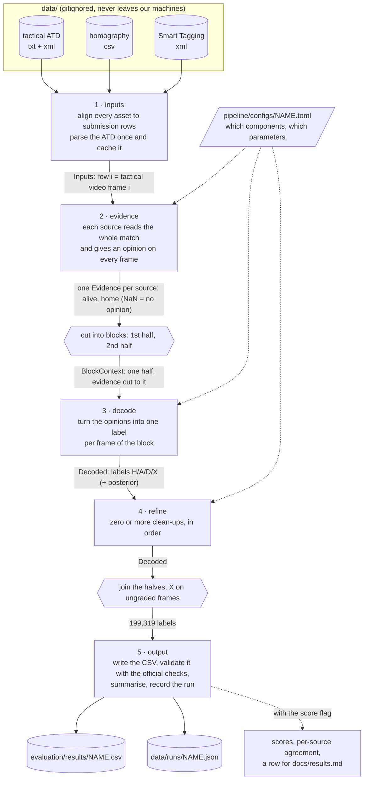

# The possession pipeline

One command goes from the data bundle to a validated submission CSV, and every run can be repeated byte for byte. The
pipeline is a chain of five stages. Each stage is a folder with its own README, and each has a small fixed contract,
so five people can work on different stages at the same time without stepping on each other.

```bash
python pipeline/run.py pipeline/configs/main.toml           # -> evaluation/results/main.csv, validated
python pipeline/run.py pipeline/configs/main.toml --score   # + public-window scores and per-source agreement
python pipeline/selftest.py                                 # contract checks on synthetic data (seconds)
python pipeline/selftest.py --data                          # + the real match: the 4 baselines, byte for byte
```

Use the team venv (`.venv/Scripts/python` on Windows, `.venv/bin/python` on macOS/Linux, Python 3.11.9). The first run
parses the tracking (~15 s); later runs take a few seconds.

## How it works



Two design decisions run through the whole diagram:

- **Opinions are separate from decisions.** Evidence sources say what the data suggests about each frame and never
  pick a label. The decoder weighs every source and pays for every label change. A new source therefore plugs in
  without touching the decoder, and a better decoder improves every source at once.
- **Decoders never see across halftime.** The runner cuts the evidence into one block per graded half before any
  decoder or refiner runs, and writes `X` outside the blocks, where nothing is graded. The per-half rule
  ([T11](../docs/traps.md)) holds for everyone without anyone having to remember it.

## The stages

| # | stage | takes | gives | its job | today | lands here |
|---|---|---|---|---|---|---|
| 1 | [inputs](inputs/README.md) | `data/tactical/*` and `games.py` | `Inputs`: read-only arrays where row *i* = tactical video frame *i*; graded halves, kick-offs, pitch size | do every alignment once and check it; parse the 195 MB ATD once and cache it | ATD (cached), homography, Smart Tagging | P10 audio, P14 ball from video, P15 broadcast |
| 2 | [evidence](evidence/README.md) | `Inputs` (the whole match) + config parameters | one `Evidence` per source: `alive` = P(ball in play), `home` = P(home has it \| in play), each float64 per frame, NaN = no opinion | per-frame opinions, never labels | `nearest_player` (baseline step 1) | P04, P05, P07, P08, P10 |
| 3 | [decode](decode/README.md) | one block (a graded half) and every source cut to it | `Decoded`: one int8 label per frame (`H`, `A`, `D`, `X` = 0–3) and an optional posterior | turn opinions into a sequence that looks like football: intervals, few spurious changes | `majority_vote` (baseline step 2, a stand-in) | P06 HMM / semi-Markov |
| 4 | [refine](refine/README.md) | the same block + the current `Decoded` | a new `Decoded`, same frames | metric-aware clean-ups, each switchable and measured | none yet | P11, P12 |
| 5 | [output](output/README.md) | labels for the whole match | the CSV (LF, validated, sha256), the run manifest; with `--score`, the scores | own the bytes of the deliverable and check them as the organisers will | — | — |

The runner ([`run.py`](run.py)) chains them, checks every hand-over (lengths, dtypes, value ranges, label codes),
and prints one line of aggregates per stage. It never prints a frame's data.

## The contracts

Defined once, in [`contracts.py`](contracts.py). A component is a plain function. Its keyword arguments are the keys
of its entry in the config.

```python
# evidence   pipeline/evidence/<name>.py   -- sees the whole match
def compute(run, **params) -> Evidence          # run.inputs, run.seed

# decoder    pipeline/decode/<name>.py     -- sees one block
def decode(ctx, **params) -> Decoded            # ctx.block, ctx.evidence (name -> Evidence, cut to the block), ctx.run

# refiner    pipeline/refine/<name>.py     -- sees one block
def refine(ctx, decoded, **params) -> Decoded
```

| type | fields |
|---|---|
| `Evidence` | `alive`, `home`: `(n,)` float64 in [0, 1], NaN = no opinion · `name`, `weight`: set by the runner from the config |
| `Block` | `half` (1, 2, or None for scope "file"), `start`, `stop` (half-open) · `take(array)` = `array[start:stop]` |
| `BlockContext` | `run` (`inputs`, `seed`), `block`, `evidence` (name → `Evidence` cut to the block, in config order) |
| `Decoded` | `labels`: int8 codes, the scorer's own (`H, A, D, X = 0, 1, 2, 3`) · `posterior`: `(len, 3)` P(H), P(A), P(D) or `None` |

Why `alive` and `home` rather than three numbers: the ground truth is `D` where the ball is dead and otherwise the
team that has it. Most sources answer only one of those two questions. A decoder recombines them as
`P(H) = alive·home`, `P(A) = alive·(1 − home)`, `P(D) = 1 − alive`.

## Configs

A run is one TOML file in [`configs/`](configs/), and its file name is the run's name:

```toml
description = "what this run tries"
seed = 0                   # all randomness derives from it
scope = "halves"           # one block per graded half; "file" only for the baseline reproduction

[[evidence]]               # one entry per source, any number
kind = "nearest_player"    # key in pipeline/evidence REGISTRY
# name = "..."             # optional; default = kind; must be unique
# weight = 1.0             # optional; how much the decoder trusts this source
# ...                      # every other key is a parameter of compute()

[decoder]                  # exactly one
kind = "majority_vote"
half_width = 50

# [[refine]]               # zero or more, applied in order
# kind = "..."
```

| config | what it is |
|---|---|
| [`main.toml`](configs/main.toml) | the team's current pipeline, i.e. the file we would submit today. It is still the baseline in substance (nearest player + ±2 s vote, per half) |
| [`smooth50_repro.toml`](configs/smooth50_repro.toml) | a regression check: it must rebuild `evaluation/results/baseline_smooth50.csv` byte for byte |

Configs are checked strictly before any data loads. An unknown key, an unknown component, a duplicate source name or
a parameter the function doesn't accept (`half_widht = 50`) stops the run with a sentence that says what to change.
Parameter *types* are not checked, so components validate their own.

**To run an experiment:** copy `main.toml` to `configs/<your_experiment>.toml`, change it, run it with `--score`,
and log it in [docs/results.md](../docs/results.md) (the run prints a ready-made scoreboard row). When an experiment
wins on validation, its changes come back into `main.toml`.

## Adding a component

| to add | write | register | use |
|---|---|---|---|
| an evidence source | `pipeline/evidence/<name>.py` with `compute(run, **params)` | one line in `evidence/__init__.py` `REGISTRY` | an `[[evidence]]` entry |
| a decoder | `pipeline/decode/<name>.py` with `decode(ctx, **params)` | one line in `decode/__init__.py` `REGISTRY` | `[decoder] kind = "<name>"` |
| a refiner | `pipeline/refine/<name>.py` with `refine(ctx, decoded, **params)` | one line in `refine/__init__.py` `REGISTRY` | a `[[refine]]` entry |
| an asset | a lazy property on `Inputs`, aligned and checked | — | `run.inputs.<asset>` |

Each stage's README has a template, its rules and the traps that apply. After any change, run
`python pipeline/selftest.py --data`. The four baselines must still come out byte for byte.

## Checks

| check | command | what it proves |
|---|---|---|
| contracts | `python pipeline/selftest.py` | every stage rejects malformed input with a readable error; the cache parses bit-exactly; the evidence and the vote equal `starter/baseline.py` on synthetic tracking with every awkward case (ties, missing balls, empty frames); nothing risky is visible to git |
| regression | `python pipeline/selftest.py --data` | on the real match, all four committed baselines are rebuilt byte for byte, and `main.toml` gives the same bytes twice |
| the file | `python evaluation/validate_submission.py <csv>` | the organisers' own format check (the pipeline already runs the same functions) |
| the scores | `python pipeline/run.py <config> --score` | public-window scores plus each source's agreement with the GT. Today `nearest_player` agrees on 77.8% of 5,640 frames, exactly [A01](../docs/results.md) |

The public window is for correctness only. It holds 17 possessions and ranks the baselines the wrong way round
([T01](../docs/traps.md)). Choose between versions on P01's benchmark of other matches, as the next section says. Hand
labels on this match are not allowed, not even for validation ([T27](../docs/traps.md)).

## Validation

Every choice between two versions of the pipeline (a decoder, a smoothing width, an evidence weight, a threshold) is
made on **P01's benchmark**, never on the public window. The window checks that a run is correct (alignment, the file,
each source's agreement) and is where we learn this ground truth's timing conventions (P02); it cannot rank versions
([T01](../docs/traps.md)). With no hand labels allowed on this match, the labels come from other matches: the seven open
DFL/IDSSE Bundesliga matches (CC BY 4.0), whose tracking is degraded to look like ours, run through the pipeline's own
components and scored by the organisers' scorer half by half.

```bash
pip install -r requirements-benchmark.txt && python pipeline/benchmark/sources.py     # once: the 7 matches, md5-checked
python pipeline/benchmark/run.py pipeline/benchmark/configs/nearest_w50.toml pipeline/configs/MINE.toml
python pipeline/benchmark/run.py pipeline/benchmark/configs/nearest_w50.toml pipeline/configs/MINE.toml --truth coarse
```

The first config is the reference, and every other one is compared with it (delta = other minus first, so positive
means the other is better). The first run parses the seven matches (3 to 5 minutes, [A05](../docs/results.md)); later
runs read them from `data/cache/` and take about 6 s a config on the default profile
([R004b](../docs/results.md)). A config must run per graded half and use only what a benchmark match has: a source that
needs the video's homography or the Smart Tagging stops the run and names the asset.

**How to read the printout.**

| it says | read it as |
|---|---|
| pooled spellF1, macroF1, alive/dead F1 | the official scorer's numbers for all halves of all matches as one file |
| per match, mean [90% t] | each match counts once; the 90% Student t interval of the seven is the only one used |
| delta vs the reference, per match [90% t] | paired over the matches; it excludes 0 only by more than 1e-12 |
| sign-flip p | exact two-sided test of the seven deltas, all 2^7 sign patterns; the smallest p is 2/128 = 0.0156 |
| wins / losses | matches with delta above / below 0, of seven; per competition too (Bundesliga 2, 2. Bundesliga 5) |
| possessions per graded minute, D share | predicted against true: flicker shows here before it shows in a score |

- **Never a bootstrap.** Seven matches are not a sample to resample, and five of them are one club's home games, so they
  are not seven independent draws either. A gap that holds in every match and in both competitions is worth more than
  one that does not. A degradation seed moves a pooled spellF1 by up to about 0.015 (R003 to R004b) and the intervals
  say nothing of that spread, so read a gap of that size with care.
- **Both truths.** `--truth raw` is DFL's flags as they are. DFL's possessions are fine-grained (437 a match, median
  3.7 s) and how fine ours are is not known ([A06](../docs/results.md), [T33](../docs/traps.md)), so `--truth coarse`
  absorbs every possession under 5 s that sits between two possessions of the other team. Run both and read them side
  by side: a choice that depends on possession length and ranks differently under the two is a warning, not a licence
  to pick the truth that suits. Absolute spellF1 on the benchmark is not our leaderboard's under either truth.
- **The yardstick check.** `nearest_w{0,25,50,125}.toml` are the organisers' four baselines decoded per half, and a
  change has to beat them here before it is worth anything. They are also the benchmark's own test: the check holds in
  its robust part (`w0` is last under both truths, R002 to R004b), the rest of the order follows the truth, and neither
  truth gives the published full-match order (Kendall tau +0.667 under each, from R003 on). It is a check, not a target
  ([T26](../docs/traps.md)).
- **Fidelity.** `python pipeline/benchmark/fidelity.py --profile tracking --seeds 3` measures how far the degraded copy
  looks like our match: eight gates, all of which must pass (it exits 1 otherwise), and ten WARN checks that are printed
  and discussed in `docs/results.md` and never tuned towards. Run it after any change to a profile. Degradations are
  fitted once on label-free statistics of our tracking, then frozen ([T37](../docs/traps.md)).

**The default profile, as of R004b, is `tracking` version 2.** The ball is missing where ours was (our own masks,
transplanted). The players have our tracklets in 46 slots, wrong-team slots (as on 10.5% of our frames), NaN speeds
in runs, smoothing, and our low-count frames (only the players nearest the ball tracked). All eight gates pass and
none of the ten checks warns ([R004b](../docs/results.md)). R005 adds a `context` profile that places the ball's
gaps where our tracker loses the ball ([A08](../docs/results.md)) and may change the default: `run.DEFAULT_PROFILE`
and the benchmark README say which is current, `--profile clean|gaps|tracking` picks another, and every report names
its profile and version.

What it cannot test: whatever uses the homography, the Smart Tagging, the camera or the audio (DFL has no video), and
the conventions of our ground truth beyond what the public window shows. Check those on the public window. The details
(profiles, gates and WARN bands, the report, limitations) are in [`benchmark/README.md`](benchmark/README.md), and what
was measured is in [`docs/results.md`](../docs/results.md) (A05 to A09, R002 to R004b).

## Rules that the code enforces, and ones it can't

- **Match data never reaches an LLM or git.** The cache lives in `data/cache/`, run manifests in `data/runs/`, and
  CSVs only go to `evaluation/results/`, `data/`, or outside the repository; the runner refuses anywhere else, and
  refuses `baseline_*` names ([T24](../docs/traps.md), [T25](../docs/traps.md)). The printouts hold aggregates only.
  Keep it that way in notebooks and docs.
- **Deterministic.** Same config, same data, same versions give the same bytes. Seed from `run.seed`, never iterate a
  set, and pin new dependencies in [`requirements-pipeline.txt`](../requirements-pipeline.txt)
  ([T20–T22](../docs/traps.md)).
- **One index everywhere.** Row *i* = tactical video frame *i*. Only stage 1 converts indices ([T08](../docs/traps.md)).
- **Labels come from an algorithm.** No component may edit particular frames by hand (RULES.md).
- **Per-frame arrays in reprs (a note for the team).** `Evidence`, `Decoded` and `run.RunResult` print their per-frame
  arrays in their default reprs, so a `print(decoded)` in a notebook shows values of this match. `contracts.py` is
  team-owned and the benchmark work left it alone; at the next change to the contracts, give those fields `repr=False`,
  as `benchmark/calibration.Calibration` does for its arrays.
- **Don't modify `evaluation/` or `starter/`.** The pipeline imports the official scorer and the organisers' loaders,
  so its checks are theirs.

## When something fails

| message starts with | meaning | fix |
|---|---|---|
| `FAILED  …toml: [decoder] 'majority_vote': unknown parameter(s) …` | a typo or a missing parameter in the config | the message lists what the component accepts |
| `FAILED  match data not found` | the bundle isn't unpacked where `games.py` looks | see CLAUDE.md "Data setup", or set `MTAH_DATA_DIR` |
| `FAILED  …csv: inside the repository, .gitignore only covers …` | `--out` points somewhere git would see | write to `evaluation/results/`, `data/`, or outside the repo |
| `ValueError: evidence 'x': home has 164488 frames …` | a source indexed the broadcast timeline | [T09](../docs/traps.md) |
| `ValueError: … x and y are not missing together` / `separator counts` | the ATD export changed shape | don't relax the check; see [inputs](inputs/README.md) |
| a regression row differs | something upstream of the decoder moved | parsing, alignment, slot teams, or the writer |

## Files

```
pipeline/
├── README.md            this overview
├── run.py               the command: config → inputs → evidence → decode/refine per block → output → manifest
├── config.py            reads and strictly checks a TOML config
├── contracts.py         Evidence, Block, RunContext, BlockContext, Decoded and their checks
├── selftest.py          synthetic contract checks; --data for the byte-exact regression
├── configs/             main.toml (current pipeline), smooth50_repro.toml (regression)
├── inputs/              stage 1: Inputs, the ATD cache                       README.md
├── evidence/            stage 2: REGISTRY, nearest_player                    README.md
├── decode/              stage 3: REGISTRY, majority_vote                     README.md
├── refine/              stage 4: REGISTRY (empty)                            README.md
├── output/              stage 5: write, validate, summarise, score, manifest README.md
└── benchmark/           validation (P01): DFL matches degraded like ours     README.md
```
